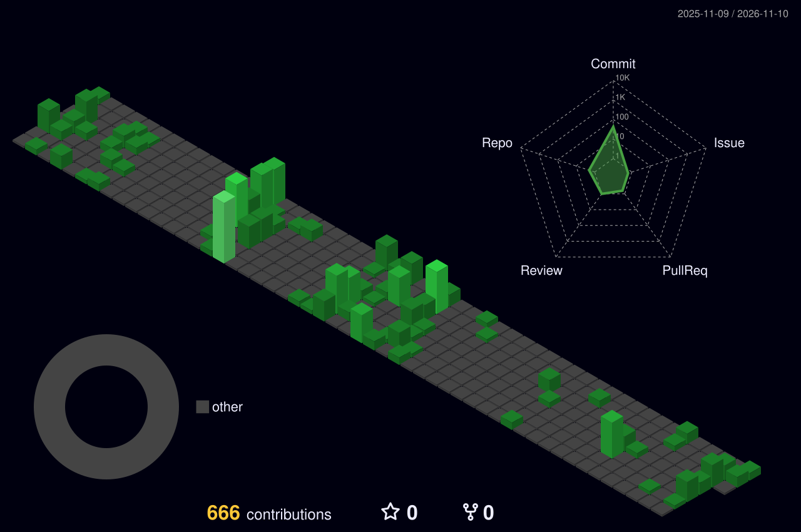
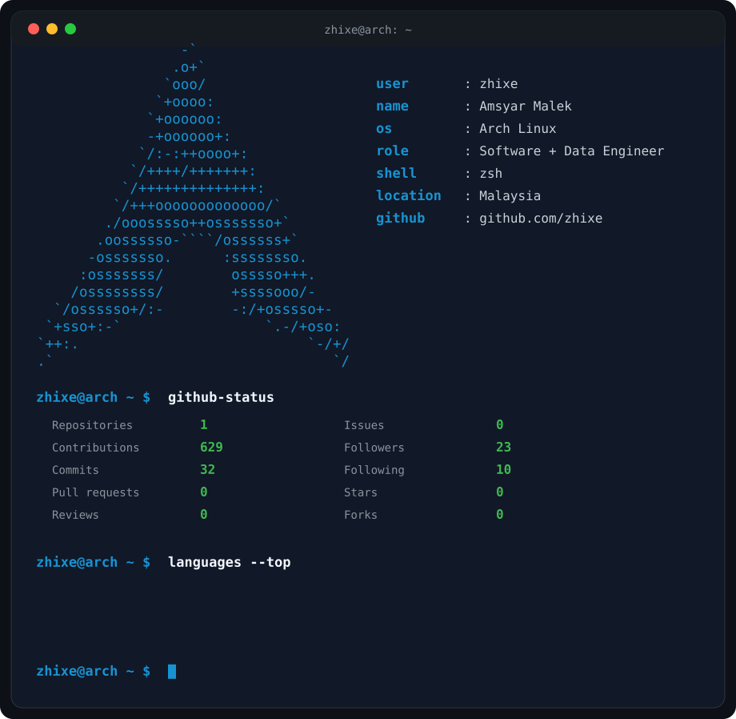

# Amsyar Malek

**Software & Data Engineer** · Malaysia 🇲🇾

I work across the path from an API request to the data platform behind it—and the infrastructure that keeps both running.

[Portfolio](https://amsyar-malek.com) · [GitHub](https://github.com/zhixe)

---

## The work I enjoy

I like understanding a system end to end: how application logic becomes an API, how data moves between services and into analytics, and how all of it behaves in production.

My focus spans backend engineering and data platforms, with attention to the operational details that make systems easier to maintain: clear service boundaries, reliable deployments, performance testing, and recovery when things go wrong.

### Where I spend my time

- **Applications:** backend services, APIs, business workflows and service integration.
- **Data:** ETL/ELT, streaming, data warehouses and analytical platforms.
- **Production:** Linux, containers, deployment verification, high availability and disaster recovery.
- **Performance:** load and stress testing, latency analysis and concurrent-user validation.

---

## My engineering toolkit

The tools change with the problem. These are the languages, platforms and practices represented in my work.

| | Tools & technologies |
|---|---|
| **Languages** | Java 17, Python, TypeScript, JavaScript, SQL, Rust |
| **Applications & APIs** | Spring Boot, Spring Security, React, NestJS, Node.js, FastAPI, JPA/Hibernate, REST APIs |
| **Data & streaming** | Apache Kafka, Apache Doris, SQL Server, IBM Informix, Liquibase, ETL/ELT, data pipelines, data warehousing |
| **Infrastructure & delivery** | Linux, Docker, Git, Nginx, Tomcat, Gradle, PM2 |
| **Testing & reliability** | JUnit, k6, integration testing, load and stress testing, observability, high availability, disaster recovery |
| **Architecture** | Modular monoliths, asynchronous processing, service boundaries, release engineering |

<!--
---

## 🧩 Engineering Interests

```text
Software Engineering
├── Backend Systems
├── REST APIs
├── Business Workflows
├── Application Architecture
└── Service Integration

Data Engineering
├── Data Pipelines
├── ETL / ELT
├── Streaming
├── Data Warehouses
├── Data Lakes
└── Analytical Platforms

System Architecture
├── Modular Monolith
├── Layered Architecture
├── API Contract Design
├── Async Processing
├── Service Boundaries
└── Resilient Integration

Platform & Reliability
├── Linux
├── Docker
├── Reverse Proxy
├── High Availability
├── Disaster Recovery
├── Deployment Verification
└── Observability

Performance Engineering
├── Unit & Integration Testing
├── Regression Testing
├── Smoke Testing
├── Load Testing
├── Stress Testing
├── Concurrent User Testing
├── Latency Analysis
└── Performance Monitoring
```
-->
---

## 🔥 GitHub Streak

<div align="center">


</div>

---

## 🧊 Yearly Contribution Graph

<div align="center">



</div>

---
<!--
## 🖥️ Engineering Console

<div align="center">



</div>
-->
## 🖥️ Engineering Console

<div align="center">


</div>

<!--

## 🐍 Contribution Snake

<div align="center">

<picture>
  <source
    media="(prefers-color-scheme: dark)"
    srcset="https://raw.githubusercontent.com/zhixe/zhixe/output/github-contribution-grid-snake-dark.svg"
  />
  <source
    media="(prefers-color-scheme: light)"
    srcset="https://raw.githubusercontent.com/zhixe/zhixe/output/github-contribution-grid-snake.svg"
  />
  
</picture>

</div>

-->
